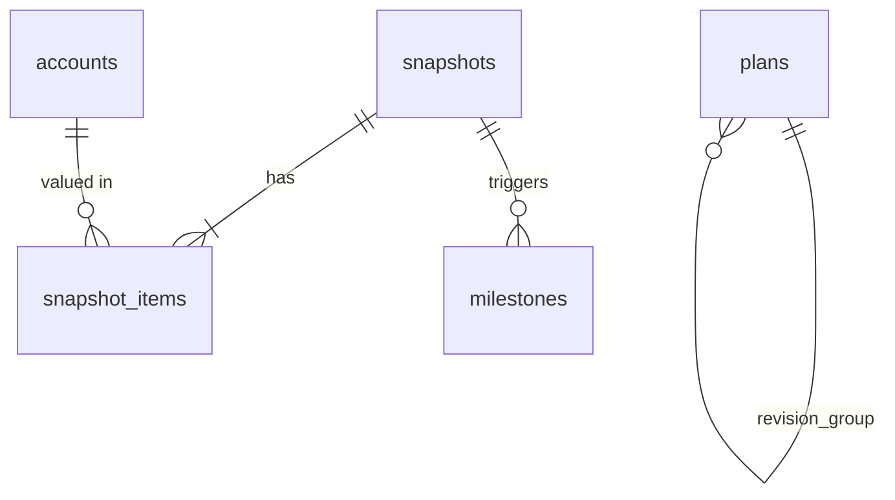

# Firedom — 시뮬레이션 엔진 계산 명세 & DB 스키마 설계

작성일: 2026-07-08 | 버전: v1.1 (2026-07-13: A11 포트폴리오 모드 추가) | 대상: `lib/engine/` (순수 Dart), `lib/data/` (Drift)

이 문서의 골든 테스트 기대값은 독립 구현(Python)으로 계산·검증된 수치다. 구현이 이 값과 다르면 **구현이 틀린 것**이다.

---

# Part A. 시뮬레이션 엔진 명세

## A0. 전역 규약 (위반 시 골든 테스트가 깨진다)

| # | 규약 | 내용 |
|---|---|---|
| R1 | 금액 단위 | 정수 원(KRW). 부동소수점 금액 금지. 중간 계산은 double 허용, **매월 말 잔액을 반올림(round)해 정수로 고정** |
| R2 | 시간 단위 | 월(month). `t=0` = 현재 월. 나이는 `age0 + t ~/ 12` |
| R3 | 실질 기준 | 엔진의 모든 금액은 **현재 가치(실질)**. 수익률도 실질수익률만 입력받는다. UI 표기: "모든 금액은 오늘 돈 가치" |
| R4 | 수익률 변환 | 명목→실질: 피셔 방정식 `r_real = (1+r_nom)/(1+π) − 1` (근사식 `r_nom − π` 금지). 연→월: 기하 변환 `r_m = (1+r)^(1/12) − 1` (산술 `r/12` 금지) |
| R5 | 저축 유입 시점 | 월말. `asset[t+1] = round(asset[t] × (1+r_m)) + S` |
| R6 | 수익률 저장 | UI/DB에서는 베이시스포인트 정수(bp). 4.00% = 400. 엔진 진입 시 double 변환 |
| R7 | 시뮬 상한 | 1,200개월(100년). 미도달 시 `unreachable` 반환 (무한루프 금지) |
| R8 | 순수성 | 엔진은 `dart:ui`, Flutter, DB에 의존하지 않는다. 입력 → 출력 순수 함수 |

## A1. 입력 모델

```dart
class PlanInput {
  final int age0;                  // 현재 나이 (만)
  final int currentAssets;         // 현재 순자산 (원)
  final int monthlySaving;         // 월 저축액 (원, 실질)
  final int realReturnBp;          // 연 실질수익률 (bp)
  final int monthlySpendRetire;    // 은퇴 후 월 생활비 (원, 실질)
  final int swrBp;                 // 안전인출률 (bp, 기본 400)
  final int lifeExpectancy;        // 기대수명 (기본 90)
  final NpsInput? nps;             // 국민연금 (선택)
  final int volatilityBp;          // 연 변동성 (bp, 몬테카를로용)
}
class NpsInput {
  final int monthlyAmount;         // 예상 월 수령액 (원, 현재가치)
  final int startAge;              // 수령 개시 나이 (기본 65)
}
```

온보딩(S1)은 `monthlySpendRetire`를 현재 월 지출로, `monthlySaving`을 소득−지출로 대입해 이 모델을 채운다.

## A2. FIRE Number와 달성 판정 — 두 가지 모드

**모드 1: 단순 모드 (연금 미입력, 온보딩 기본)**

```
FIRE_number = round(monthlySpendRetire × 12 / swr)
FIRE 시점 tF = min{ t : asset[t] ≥ FIRE_number }   (A3의 축적 시뮬로 탐색)
```

**모드 2: 인출 판정 모드 (연금 입력 시 — 이것이 정본)**

연금이 있으면 "필요 자산" 공식이 브릿지 구간 때문에 단일 값으로 안 떨어진다. 따라서 공식 역산이 아니라 **실현 가능성 판정**으로 정의한다:

```
feasible(R) = R개월 후 은퇴를 가정하고 기대수명까지 인출 시뮬(A4)을 돌렸을 때
              잔액이 한 번도 음수가 되지 않으면 true
FIRE 시점 tF = min{ R : feasible(R) }
```

`feasible`은 R에 대해 단조(더 늦게 은퇴할수록 유리)라고 가정하고 이분 탐색 허용. 표시용 FIRE Number = `asset[tF]` (그 시점 잔액).

## A3. 축적(Accumulation) 시뮬

```
asset[0] = currentAssets
asset[t+1] = round(asset[t] × (1 + r_m)) + monthlySaving
```

출력: 월별 잔액 배열(계획 궤도 = 홈 S3의 점선), FIRE 시점, D-day.

## A4. 인출(Drawdown) 시뮬

은퇴월 R부터 기대수명 월 L까지:

```
income[t] = (t ≥ npsStartMonth) ? nps.monthlyAmount : 0
asset[t+1] = round(asset[t] × (1 + r_m)) + income[t] − monthlySpendRetire
실패 조건: asset[t+1] < 0
```

주의: 인출·연금 모두 실질 고정액(R3). 인플레 연동 인출은 실질 기준에서는 "상수 인출"과 동치이므로 별도 처리 없음.

## A5. What-if (S2·S4 슬라이더)

별도 로직 없음 — `PlanInput`의 해당 필드만 바꿔 A2를 재호출. 요구 성능: 온보딩 슬라이더는 모드 1(단일 배열 스캔)이므로 마이크로초 단위, debounce 불필요.

## A6. 몬테카를로 (유료, isolate 실행)

- 월 수익률 샘플링: 로그정규. `μ_m = ln(1 + r_real)/12 − σ_m²/2`, `σ_m = σ_annual / √12`, `r_t = exp(N(μ_m, σ_m)) − 1`
- 경로 수: 기본 5,000 (설정 가능). 각 경로: 축적(A3의 r_m을 r_t로 치환) → tF 이후 인출(A4 동일 치환)
- **성공 정의**: 기대수명까지 잔액 ≥ 0 유지. 성공 확률 = 성공 경로 / 전체 경로
- 산출물: 성공 확률(무료 티저 1줄), 잔액 분포 밴드 p10/p50/p90 (유료 차트), 자산 고갈 나이 분포 (유료)
- **시드 규약**: `seed = fnv1a(입력 파라미터 직렬화 문자열)` — 동일 입력이면 항상 동일 결과 (유저 신뢰 + 테스트 가능성). "다시 계산" 버튼은 seed+1
- 골든 테스트: 경로 단위 재현은 구현 의존적이므로, **통계적 검증**으로 한다 — G7 참조

수익률 프리셋 (모두 실질 기준, 근거 출처는 출시 전 확정 — PRD 미해결 질문):

| 프리셋 | 실질수익률 | 변동성 |
|---|---|---|
| 보수 | 250bp | 800bp |
| 중립 (기본) | 400bp | 1200bp |
| 공격 | 550bp | 1700bp |

## A7. 궤도 편차 (홈 S3 배지 "계획보다 N개월 앞")

```
W_plan[·] : 활성 계획의 축적 곡선 (계획 수립 시점 기준)
W_actual  : 최신 스냅샷 순자산, t_now = 계획 시작월부터 경과 월수
t_equiv = min{ s : W_plan[s] ≥ W_actual }   (선형 보간으로 소수 월 허용)
편차 = t_equiv − t_now   (양수 = 앞섬, 음수 = 뒤처짐)
```

엣지: `W_actual ≥ FIRE_number` → "이미 목표 도달" / 스냅샷 < 2개 → 편차 미표시(PRD S3).

## A8. 저축률 (S3·S6)

```
저축률 = (income − expense) / income    (income ≤ 0 이면 미정의 → "—" 표시)
```

스냅샷의 income/expense 입력값 사용. 음수 저축률 허용(지출>소득), 표시 하한 −100%.

## A9. 엣지 케이스 계약표

| 케이스 | 엔진 동작 |
|---|---|
| monthlySaving ≤ 0 이고 asset < target, r ≤ 0 | `unreachable` (에러 아님 — UI가 S2 안내 문구 처리) |
| 이미 asset ≥ FIRE_number | tF = 0, D-day "달성" |
| r_real = 0 | 정상 계산 (선형 축적) — G6 |
| r_real < 0 | 허용 (인플레 > 명목수익) |
| nps.startAge ≤ 은퇴 나이 | 브릿지 구간 0 — 정상 처리 |
| lifeExpectancy ≤ 현재 나이 | 입력 검증 단계에서 거부 (엔진 도달 전) |
| 1,200개월 내 미도달 | `unreachable` |

## A10. 골든 테스트 케이스 (기대값 검증 완료)

공통: R1~R7 규약 준수 시 아래 값과 **정확히 일치**해야 한다 (반올림 규약까지 동일하므로 오차 0).

| ID | 입력 | 기대 출력 |
|---|---|---|
| G1 | age 35, 자산 1억, 저축 200만/월, 실질 400bp, 은퇴 후 300만/월, SWR 400bp | FIRE_number = 900,000,000 / tF = **231개월** (54세 3개월) / asset[231] = **901,642,042** |
| G2 | G1에서 저축 250만/월 | tF = **201개월** → **30개월 단축** / asset[201] = 902,242,019 |
| G3 | age 40, 자산 3억, 저축 250만/월, 실질 400bp, 은퇴 후 250만/월, 국민연금 100만/월 65세부터, 수명 90 (모드 2) | tF = **64개월** (45세 4개월) |
| G3b | G3에서 연금 제거 | tF = **82개월** (46세 10개월) — 연금 반영이 은퇴를 18개월 앞당김 |
| G4 | G1에서 자산 10억 | tF = **0** ("이미 달성") |
| G5 | 자산 5억, 저축 0, 실질 400bp, 목표 9억 | tF = **180개월** / asset[180] = 900,471,756 |
| G6 | G1에서 실질 0bp | tF = **400개월** / asset[400] = 정확히 900,000,000 |
| G7 | 몬테카를로: G1 입력 + 변동성 1200bp, 5,000경로, 은퇴 tF=231 고정, 수명 90 | 통계 검증: 성공 확률 ∈ (0.5, 1.0), 동일 시드 2회 실행 결과 완전 일치, p10 ≤ p50 ≤ p90 |

구현 순서 권장: G6(가장 단순) → G1/G2/G4/G5 → G3(모드 2) → G7.

## A11. 포트폴리오 모드 (S4-2, v1.1 — P1)

단일 `realReturnBp` 가정을 자산군별 비중으로 확장하는 **프리프로세서**. 엔진 본체(A2~A6)는 변경하지 않는다 — 포트폴리오 입력을 (수익률, 변동성) 쌍으로 축약해 `PlanInput`에 넣는 계층.

### 입력 모델

```dart
class PortfolioInput {
  final List<PortfolioHolding> holdings;
}
class PortfolioHolding {
  final String assetKey;     // 자산군 키 (아래 프리셋 표)
  final int weightBp;        // 비중 (bp, 합계 10000 필수)
  final int realReturnBp;    // 연 실질수익률 가정 (bp) — 프리셋 기본값, 유저 수정 가능
  final int volatilityBp;    // 연 변동성 가정 (bp)
}
```

### 1단계 (v1.1): 가중 평균 축약

```
r_port_bp = round( Σ (weightBp_i × realReturnBp_i) / 10000 )
σ_port_bp = round( Σ (weightBp_i × volatilityBp_i) / 10000 )   // 상관계수 1 가정 — 보수적 상한
```

- `r_port_bp` → `PlanInput.realReturnBp`, `σ_port_bp` → `PlanInput.volatilityBp`로 투입. 이후 A2~A6 그대로
- σ의 가중 평균은 상관 1 가정이라 실제보다 크다(분산효과 무시) — UI에 "간이 추정" 표기, 2단계에서 대체
- 검증: `Σ weightBp ≠ 10000`이면 엔진 진입 전 거부 (자동 정규화 제안은 UI 레이어 책임)
- `weightBp = 0` 항목은 무시. 단일 자산 10000 허용

### 2단계 (v2): 상관행렬 몬테카를로

- 자산군별 월 수익률을 다변량 정규로 샘플링: 공분산 `Σ = D·C·D` (D = diag(σ_m), C = 상관행렬), 촐레스키 분해 `L`로 `r_t = μ_m + L·z`
- 포트폴리오 월 수익률 `r_port,t = Σ (w_i × r_i,t)` — **매월 목표 비중으로 리밸런싱 가정**(비중 상수)을 명시적 모델링 가정으로 문서화
- 시드 규약은 A6과 동일 (입력 직렬화에 holdings 포함)

### 자산군 프리셋 (실질·연 기하평균 기준 — 근거·출처는 `자산군_프리셋_근거.md`)

등급 ✅ = 1차 출처 검증(3표 교차) / ⚠️ = 잠정(출시 전 확정 필요, PRD §11):

| assetKey | 자산군 | 실질수익률 | 변동성 | 등급 |
|---|---|---|---|---|
| us_sp500 | S&P500 | 650bp | 2000bp | ✅ |
| us_nasdaq100 | 나스닥100 | 750bp | 2400bp | ⚠️ |
| us_dow | 다우존스 | 600bp | 1900bp | ⚠️ |
| kr_equity | 국내주식(KOSPI) | 400bp | 2200bp | ⚠️(변동성 계층 ✅) |
| global_dm_em | 선진국·신흥국 | 450bp | 1800bp | ✅/⚠️ |
| kr_treasury | 국고채 | 100bp | 800bp | ⚠️(구간 근거 ✅) |
| us_treasury | 미국채(환노출) | 150bp | 900bp | ✅ USD 기준 |
| usd_cash | 달러(외환) | 50bp | 300bp | ✅ USD 기준 |
| krw_deposit | 원화 예금 | 50bp | 100bp | ⚠️ |
| gold | 금 | 200bp | 2500bp | ✅ 기간 민감 |
| silver | 은 | 100bp | 3000bp | ⚠️ |
| commodities | 원자재 | 100bp | 2000bp | ⚠️ |
| reits | 리츠 | 350bp | 2000bp | ⚠️ |

프리셋은 DB가 아니라 **엔진 패키지 정적 상수**로 내장 (완전 로컬, 시세 연동 없음). 값 변경은 앱 릴리스로 배포하고, 출처 문자열을 함께 보관해 "가정 보기"에 노출. 해외자산은 USD 기준 수치 — 환노출 시 USD/KRW 변동 추가는 미반영(근거 문서 §3, 후속 소싱). 주의: 기하평균 기준(산술평균 혼용 금지), 금은 측정 기간에 따라 실질 0.6~4.9%로 벌어지는 레짐 민감 자산.

### 예시 구성 (UI 명명은 "예시 구성" — "추천" 금지, PRD S4-2)

| 구성 | holdings (weightBp) |
|---|---|
| 균형형 | us_sp500 2500 · us_nasdaq100 1500 · kr_equity 1000 · us_treasury 2000 · kr_treasury 1000 · gold 1000 · usd_cash 500 · krw_deposit 500 |
| 안정형 / 성장형 / 올웨더 | v1.1 구현 시 확정 |

### 골든 테스트 추가

| ID | 입력 | 기대 출력 |
|---|---|---|
| G8 | 균형형 구성 (위 표, 프리셋 기본 가정) | r_port = **380bp** (정확히), σ_port = **1610bp** / G1 입력의 realReturnBp를 380bp로 바꾼 A3 결과와 포트폴리오 모드 결과가 **완전 일치** (축약 동치성 — 신규 기대값 불필요) |

---

# Part B. DB 스키마 (SQLite / Drift)

## B0. 전역 규약

- PK: **UUID v4 TEXT** (auto-increment 금지 — v1.x 동기화 대비)
- 모든 테이블: `created_at`, `updated_at` (unix epoch millis, INTEGER), soft delete `deleted_at` (nullable)
- 금액: INTEGER 원 / 비율: INTEGER bp / 연월: INTEGER `yyyymm` (예: 202607)
- 조회 시 `deleted_at IS NULL` 기본 필터 (Drift 쿼리 헬퍼로 강제)

## B1. 테이블 정의

### plans — 계획(목표+가정), 수정 = 새 리비전 append

| 컬럼 | 타입 | 설명 |
|---|---|---|
| id | TEXT PK | UUID |
| revision_group | TEXT | 같은 계획의 리비전 묶음 ID (첫 리비전의 id) |
| is_active | INTEGER | 활성 계획 여부 (활성은 전체에서 1개) |
| fire_type | TEXT | lean/fat/coast/barista |
| birth_ym | INTEGER | 생년월 yyyymm (나이 계산 원천) |
| current_assets | INTEGER | 계획 수립 시점 순자산 (궤도 기준점) |
| monthly_saving | INTEGER | |
| real_return_bp | INTEGER | |
| volatility_bp | INTEGER | |
| monthly_spend_retire | INTEGER | |
| swr_bp | INTEGER | 기본 400 |
| life_expectancy | INTEGER | 기본 90 |
| nps_monthly | INTEGER NULL | 국민연금 월액 |
| nps_start_age | INTEGER NULL | |
| started_ym | INTEGER | 궤도 t=0에 해당하는 연월 |
| created_at / updated_at / deleted_at | INTEGER | |

계획 수정 = 기존 행 `is_active=0` + 새 행 insert (같은 revision_group). 홈 차트의 "계획 변경 마커"는 리비전들의 created_at. **계획 곡선은 저장하지 않는다** — 엔진이 plans 행에서 매번 재계산 (수십 ms, 캐시 불필요).

### accounts — 자산 항목 마스터 (S8 첫 셋업에서 생성)

| 컬럼 | 타입 | 설명 |
|---|---|---|
| id | TEXT PK | |
| name | TEXT | "미래에셋 연금저축" 등 유저 자유 입력 |
| asset_class | TEXT | equity/bond/cash/real_estate/pension/other |
| account_type | TEXT | normal/isa/pension_savings/irp/dc_db/other — **v2 절세 인출 시뮬의 기반, v1부터 수집** |
| is_liability | INTEGER | 1이면 부채 (금액 음수 강제) |
| include_in_fire | INTEGER | FIRE 자산 포함 여부 (거주 부동산 제외 토글) |
| sort_order | INTEGER | |
| created_at / updated_at / deleted_at | | |

### snapshots — 월 1회 기록 헤더

| 컬럼 | 타입 | 설명 |
|---|---|---|
| id | TEXT PK | |
| ym | INTEGER | yyyymm. **부분 유니크**: 동일 ym에 deleted_at IS NULL 행은 1개 (인덱스로 강제) |
| income | INTEGER NULL | 이번 달 세후 소득 (저축률용, 선택 입력) |
| expense | INTEGER NULL | 이번 달 지출 |
| note | TEXT NULL | |
| created_at / updated_at / deleted_at | | |

### snapshot_items — 스냅샷의 항목별 금액

| 컬럼 | 타입 | 설명 |
|---|---|---|
| id | TEXT PK | |
| snapshot_id | TEXT FK → snapshots | ON DELETE는 사용 안 함 (soft delete만) |
| account_id | TEXT FK → accounts | |
| amount | INTEGER | 부채는 음수 |
| created_at / updated_at / deleted_at | | |

순자산 = `SUM(amount)` (include_in_fire=1인 계정만; 파생값이므로 저장하지 않음). "전월 복사" = 직전 ym 스냅샷의 items를 새 스냅샷으로 복제.

### scenarios — 시뮬 놀이터 저장 (S4·S4-2)

id, name, params_json (PlanInput 직렬화 + 선택적 `portfolio` 필드: A11 holdings 배열), created_at/updated_at/deleted_at. 무료 1개 제한은 앱 레이어에서.

포트폴리오는 v1.1에서 **놀이터(시나리오) 전용** — plans에는 반영하지 않는다 (S4 원칙: 저장 전까지 목표 불변, 계획은 축약된 단일 수익률 유지). 계획 자체에 포트폴리오 가정이 필요해지면 `plans.portfolio_json` NULL 컬럼을 additive 마이그레이션으로 추가 (v2 검토). 자산군 프리셋은 DB가 아닌 엔진 정적 상수(A11).

### milestones — 달성 기록

id, milestone_key (TEXT: `net_worth_100m`, `fire_25pct`, `saving_rate_50_6mo` …), achieved_ym, snapshot_id FK, created_at. 달성 판정은 스냅샷 저장 시 엔진이 수행, 결과만 기록 (재계산으로 복원 가능하지만 "달성 순간"의 UX 이벤트 로그로서 저장).

### settings — k/v 단일 테이블

key TEXT PK, value TEXT(JSON), updated_at. 항목: 알림 설정, 금액 가림 기본, 구독 entitlement 캐시, schema_version은 Drift 관리.

## B2. ERD



## B3. 인덱스

- `snapshots(ym) WHERE deleted_at IS NULL` — UNIQUE
- `snapshot_items(snapshot_id)`, `snapshot_items(account_id)`
- `plans(is_active) WHERE deleted_at IS NULL`

## B4. 백업/복원 포맷 (S10)

```json
{ "format": "firedom-backup", "schema_version": 3, "exported_at": 1751900000000,
  "data": { "plans": [...], "accounts": [...], "snapshots": [...],
            "snapshot_items": [...], "scenarios": [...], "milestones": [...], "settings": [...] } }
```

- 직렬화 후 **AES-256-GCM** 암호화, 키는 패스프레이즈에서 PBKDF2(≥600k iter) 유도. salt·iv는 파일 헤더에 평문 포함
- 복원 규칙: schema_version이 현재보다 낮으면 마이그레이션 체인 통과 후 적재, 높으면 거부("앱 업데이트 필요")
- 복원은 전체 치환(merge 아님) — 동기화가 아니라 기기 이전 용도임을 UI에 명시

## B5. 마이그레이션 정책

- Drift `schemaVersion` 관리, 마이그레이션은 추가적(additive) 우선 — 컬럼 삭제 대신 deprecated 주석
- **모든 마이그레이션에 테스트**: 이전 버전 실데이터 fixture → 마이그레이션 → 무결성 검증 (수년치 수기 데이터가 자산인 앱에서 마이그레이션 실패 = 치명상)
- 백업 포맷 버전은 schema_version과 동일 축으로 관리

## B6. 구현 착수 순서 (Claude Code 세션에 그대로 지시 가능)

1. `lib/engine/` — PlanInput/결과 모델, A3 축적 시뮬 + G6·G1·G2·G4·G5 골든 테스트
2. A4 인출 판정(모드 2) + G3/G3b
3. A6 몬테카를로(isolate) + G7 통계 테스트
4. `lib/data/` — Drift 테이블(B1) + 마이그레이션 테스트 스캐폴드
5. A7 궤도 편차 + A8 저축률 (엔진·DB 결합 첫 지점)
6. (v1.1) A11 포트폴리오 모드 — 가중 축약 프리프로세서 + 자산군 프리셋 상수 + G8 동치성 테스트
